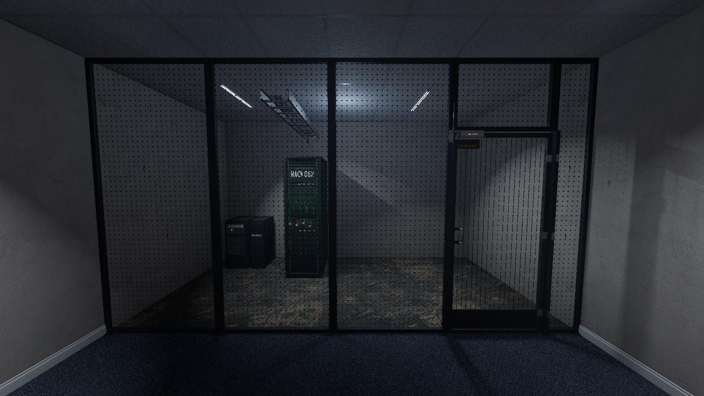
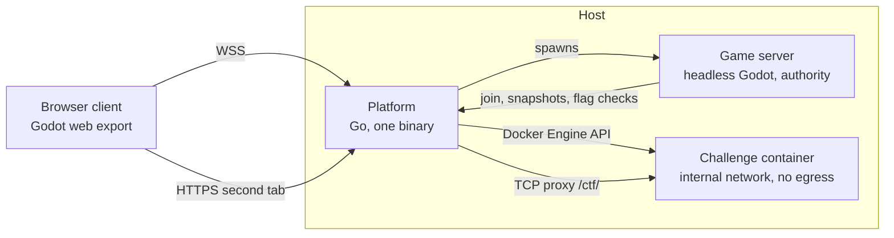

# Lockwright

Co-op virtual escape rooms, played in the browser, where some rooms contain a **real CTF challenge**: a laptop in the 3D room is a real, intentionally vulnerable web app running in an isolated container. When the team captures its flag, a door opens in the game world.

This repository holds the platform and its one hacker room, **Night Shift**. It is a working prototype built in October 2026. It ran on a home server and was play-tested with friends over the internet.

A *lockwright* is a master maker of locks, and every room is one of his locks. The project's working codename was `escapebox`, which is why it still appears in code identifiers (the room SDK `escapebox_sdk`, Docker labels, file names) and in the older docs and commits.


| Lobby | The server cage |
|---|---|
|  |  |

## Night Shift

23:10 at a logistics company's regional office. The badge system has crashed, the mains have gone, and the office maglock has shut the team in. They find clues in the room (a sticky note, a reused Wi-Fi password, a password policy, an anniversary card) and use them against the company intranet, which really runs:

- **The intranet** (`game/rooms/night_shift/ctf/intranet/`) is a small Go web app with one deliberate flaw, an IDOR in ticket access. Server-side expiring sessions with logout revocation (`HttpOnly`, `SameSite=Lax`, `Secure` over HTTPS), HTML escaping, constant-time credential checks, bounded per-username login lockout (without username enumeration), request body limits and HTTP server timeouts are implemented properly, so the IDOR is the intended way in. The facilities ticket holds a per-session flag.
- **Hard difficulty** removes the password from the room. Players get a `shadow.bak` from a USB stick with a sha512crypt hash and decoy accounts, plus clues to the password pattern. Online guessing is blocked by the lockout, so they crack it offline with John, hashcat (`-m 1800`) or their own script. A Go test fails if the hash and the challenge password drift apart.
- Pasting the flag into the in-world cage controller drops the server cage's maglock. The flag is validated server-side by the platform, never by the client.

The rest of the room is physical puzzles: UV ink, a keypad cabinet, a patch panel wired from a network diagram, and an exit override code.

## Architecture



- **Game** (`game/`): Godot 4.7, GDScript. A headless game server is the only authority over world and puzzle state; clients send intents and get state back. Movement is validated server-side, and puzzle prerequisites are gated before any change (`docs/DECISIONS.md`, ADR-0009/0010/0016).
- **Rooms are plug-ins** (`game/rooms/<id>/`): a `room.yaml` manifest (puzzle graph, solution, hints, difficulties) validated against a JSON Schema by `tools/roomcheck`, plus a scene built from SDK nodes (`game/addons/escapebox_sdk/`). The core never names a room.
- **Platform** (`platform/`): Go standard library plus a pure-Go SQLite driver. It handles sessions and join codes, the lobby site, room-pack downloads, game-server processes and CTF orchestration.

### Sandboxing the challenge (ADR-0018, ADR-0032)

- Each game gets its own `internal: true` Docker bridge (`ebx`-prefixed interface, no default route, no egress). Players reach it through the platform's TCP proxy (capped connections, idle timeouts, half-close). With `-public-url`, traffic goes through `/ctf/{session}/{challenge}/`, proxies bind to `127.0.0.1` (override with `-challenge-bind` for LAN play), and raw host/port are omitted from challenge handles.
- **Host boundary:** even on an `internal: true` bridge, a container can reach host services listening on `0.0.0.0` via the bridge gateway IP (not `127.0.0.1`; `gateway_mode_ipv4=isolated` removes the gateway IP and breaks the proxy). Bind host services to loopback (`-addr 127.0.0.1:<port>` behind a local proxy, as `tools/install-service.sh` does) and drop new inbound traffic from challenge bridges (`ebx+`) while allowing established replies:
  ```bash
  iptables -I INPUT -i ebx+ -m conntrack --ctstate ESTABLISHED,RELATED -j ACCEPT
  iptables -A INPUT -i ebx+ -j DROP
  ```
- Containers run with `cap_drop: ALL`, `no-new-privileges:true`, `Privileged: false`, read-only rootfs (`noexec,nosuid` 16 MB tmpfs at `/tmp`), non-root `User: 65534:65534` enforced by the platform, no swap (`MemorySwap == Memory`), and CPU/memory/PID limits from `room.yaml` (defaults: 0.5 CPU, 256 MB, 128 PIDs). Night Shift's intranet is a static Go binary on `scratch`. Unit tests and `tools/m3_smoke.sh` check these settings.
- **Same-origin `/ctf/` proxy:** proxied responses add `Content-Security-Policy: sandbox allow-forms allow-scripts allow-popups` (no `allow-same-origin`), putting challenge pages in a `null` origin so challenge XSS cannot read platform cookies, storage or API responses. Because browsers treat `null`-origin `POST`s as cross-site, `SameSite=Lax` cookies are omitted on browser `POST` forms (browser Sign out clears the cookie locally and relies on session TTL rather than server-side revocation). For full isolation or challenges needing authenticated `POST` forms, host challenges on a separate origin.
- The platform talks to Docker over the unix socket with the standard library (~10 calls), honours `DOCKER_HOST`, and uses a no-redirect, timed HTTP client for health probes. **Rootless Docker does not work unchanged:** container IPs live inside rootlesskit's network namespace, where the host proxy cannot dial them directly (ADR-0018).
- Flags are `HMAC-SHA256(platform_secret, session | challenge)` (no plaintext stored, stable across restarts), compared in constant time, atomically rate-limited (10/min, then doubling cooldown capped at 15 min); attempts are logged without their value.
- Cleanup removes only containers and networks with this platform's owner id (a test platform once removed a live game's challenge).

## Running it

Needs Go 1.27+, Godot 4.7.2 (on `PATH` as `godot`), and Docker for the CTF challenge. Linux is the tested host.

```bash
tools/test.sh                  # everything CI runs: gofmt, go vet/test, roomcheck, assetcheck,
                               # the challenge's tests, gdUnit4, pack replay, touch play-through
tools/play.sh night_shift      # platform + game server + Docker challenge, opens the game
tools/play.sh --hard night_shift
```

Without Docker, `godot --path game -- --room night_shift` plays the room locally. The CTF step then has no live intranet.

## Repository map

| Path | What |
|---|---|
| `PLAN.md` | The original plan: decisions, architecture, milestones |
| `docs/DECISIONS.md` | Architecture decision records (ADRs), in order |
| `docs/STATUS.md` | Milestone checklist with what was actually run, and where |
| `docs/research/03-ctf-integration.md` | Research behind the CTF design |
| `docs/ROOM_AUTHORING.md`, `docs/API.md` | Room SDK and platform API |
| `platform/` | Go platform (sessions, flags, Docker orchestrator, web) |
| `game/` | Godot project: core, SDK, the Night Shift room, tests |
| `tools/` | Room and asset checks, room packer, play and test scripts, Blender asset pipeline |

## How it was built

Built by one developer working with AI coding agents. Claude Code wrote the runtime code (Godot, Go, rooms). Codex built the 3D props and printed documents through scripted, headless Blender. The plan, ADRs and status log record each decision and each verification run.
