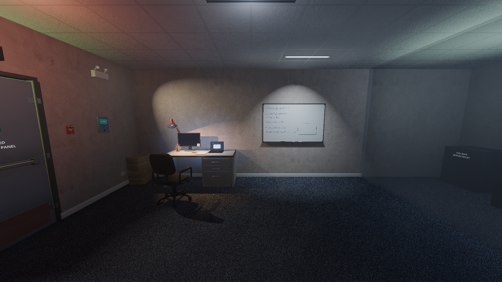
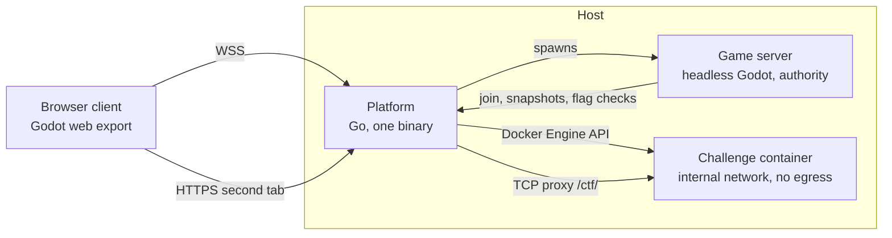

# Lockwright

Co-op virtual escape rooms, played in the browser, where some rooms contain a **real CTF challenge**: a laptop in the 3D room is a real, intentionally vulnerable web app running in an isolated container. When the team captures its flag, a door opens in the game world.

This repository holds the platform and its one hacker room, **Night Shift**. It is a working prototype built in October 2026. It ran on a home server and was play-tested with friends over the internet.

A *lockwright* is a master maker of locks, and every room is one of his locks. The project's working codename was `escapebox`, which is why it still appears in code identifiers (the room SDK `escapebox_sdk`, Docker labels, file names) and in the older docs and commits.



| Lobby | The server cage |
|---|---|
|  |  |

## Night Shift

23:10 at a logistics company's regional office. The badge system has crashed, the mains have gone, and the office maglock has shut the team in. They find clues in the room (a sticky note, a reused Wi-Fi password, a password policy, an anniversary card) and use them against the company intranet, which really runs:

- **The intranet** (`game/rooms/night_shift/ctf/intranet/`) is a small Go web app with one deliberate flaw, an IDOR in ticket access. Server-side expiring sessions with logout revocation (`HttpOnly`, `SameSite=Lax`, `Secure` over HTTPS), HTML escaping, constant-time credential checks, bounded per-username login lockout (without username enumeration), request body limits and HTTP server timeouts are implemented properly, so the IDOR is the intended way in. The facilities ticket holds a per-session flag.
- **Hard difficulty** removes the password from the room. Players get a `shadow.bak` from a USB stick with a sha512crypt hash and decoy accounts, plus clues to the password pattern. Online guessing is blocked by the lockout, so they crack it offline with John, hashcat (`-m 1800`) or their own script. A Go test fails if the hash and the challenge password drift apart.
- Pasting the flag into the in-world cage controller drops the server cage's maglock. The flag is validated server-side by the platform, never by the client.

The rest of the room is physical puzzles: UV ink, a keypad cabinet, a patch panel wired from a network diagram, and an exit override code.

## Architecture



- **Game** (`game/`): Godot 4.7, GDScript. A headless game server is the only authority over world and puzzle state; clients send intents and get state back. Movement is validated server-side, and puzzle prerequisites are gated before any change (`docs/DECISIONS.md`, ADR-0009/0010/0016).
- **Rooms are plug-ins** (`game/rooms/<id>/`): a `room.yaml` manifest (puzzle graph, solution, hints, difficulties) validated against a JSON Schema by `tools/roomcheck`, plus a scene built from SDK nodes (`game/addons/escapebox_sdk/`). The core never names a room.
- **Platform** (`platform/`): Go standard library plus a pure-Go SQLite driver. It handles sessions and join codes, the lobby site, room-pack downloads, game-server processes and CTF orchestration.

### Sandboxing the challenge (ADR-0018, ADR-0032)

- Each game gets its own Docker bridge network created with `internal: true`, so a challenge has no default route and no internet egress. Players reach challenges through the platform's TCP proxy (capped concurrent connections, idle timeouts, half-close support). When `-public-url` is set, challenge traffic goes through `/ctf/{session}/{challenge}/`, challenge proxies bind to `127.0.0.1` by default (configurable with `-challenge-bind` for LAN play), and raw host/port pairs are omitted from challenge handles.
- **Container-to-host boundary:** on a Docker bridge network (even with `internal: true`), Docker still assigns the host a bridge gateway IP in the container's subnet so the host proxy can dial the container. A compromised container can therefore open TCP connections to host services bound to `0.0.0.0` via that gateway IP, though not to services bound to `127.0.0.1`. (Docker's `gateway_mode_ipv4=isolated` removes the gateway IP, which also prevents the host proxy from reaching the container.) Bind host services—including the platform itself (`-addr 127.0.0.1:<port>`) when behind a local reverse proxy—to loopback, and drop new inbound connections from Docker bridges on the host firewall while permitting replies to host-initiated proxy connections:
  ```bash
  # iptables (or the equivalent nftables input chain rule)
  iptables -I INPUT -i br-+ -m conntrack --ctstate ESTABLISHED,RELATED -j ACCEPT
  iptables -A INPUT -i br-+ -j DROP
  ```
- Containers run with `cap_drop: ALL`, `no-new-privileges:true`, `Privileged: false`, a read-only root filesystem with a `noexec,nosuid` 16 MB tmpfs at `/tmp`, non-root `User: 65534:65534` enforced by the platform (even if an image omits `USER`), and CPU, memory (with `MemorySwap == Memory`, disabling swap) and PID limits from `room.yaml` (defaults: 0.5 CPU, 256 MB, 128 PIDs). Night Shift's intranet is a static Go binary on `scratch`. Unit tests and `tools/m3_smoke.sh` check these settings on created containers.
- **Same-origin `/ctf/` proxy:** proxied `/ctf/` responses add `Content-Security-Policy: sandbox allow-forms allow-scripts allow-popups` (without `allow-same-origin`), isolating challenge pages in an opaque (`null`) origin so challenge XSS cannot read platform cookies, storage or same-origin API responses. Because browsers treat opaque-origin `POST`s as cross-site, `SameSite=Lax` cookies are omitted on browser `POST` forms (clicking Sign out in a browser clears the cookie client-side via `Set-Cookie` and relies on session TTL rather than immediate server-side revocation; direct/CLI `POST`s and `GET` navigations are unaffected). For full origin isolation—or challenges that need authenticated `POST` forms—deploy challenges on a separate origin (for example a dedicated subdomain).
- The platform talks to the Docker Engine API over the unix socket with the standard library, about ten calls, and honours `DOCKER_HOST`. A fake Engine in `httptest` keeps the orchestrator testable. **Rootless Docker does not work unchanged:** rootless Docker places container IPs inside rootlesskit's network namespace, so the host TCP proxy cannot dial them directly (ADR-0018).
- Health-check probes use a dedicated HTTP client with a timeout and redirects disabled so a challenge cannot redirect probes to host loopback services.
- Flags are `HMAC-SHA256(platform_secret, session | challenge)`. Nothing is stored in plaintext, and a restarted container gets the same flag. Comparison is constant-time. Wrong attempts are atomically rate limited (10 per rolling minute, then a doubling cooldown capped at 15 minutes) and logged without their value.
- Cleanup removes only containers and networks labelled with the platform's own owner id. This came from a real incident: a test platform once removed a live game's challenge.

## Running it

Needs Go 1.27+, Godot 4.7.2 (on `PATH` as `godot`), and Docker for the CTF challenge. Linux is the tested host.

```bash
tools/test.sh                  # everything CI runs: gofmt, go vet/test, roomcheck, assetcheck,
                               # the challenge's tests, gdUnit4, pack replay, touch play-through
tools/play.sh night_shift      # platform + game server + Docker challenge, opens the game
tools/play.sh --hard night_shift
```

Without Docker, `godot --path game -- --room night_shift` plays the room locally. The CTF step then has no live intranet.

## Repository map

| Path | What |
|---|---|
| `PLAN.md` | The original plan: decisions, architecture, milestones |
| `docs/DECISIONS.md` | Architecture decision records (ADRs), in order |
| `docs/STATUS.md` | Milestone checklist with what was actually run, and where |
| `docs/research/03-ctf-integration.md` | Research behind the CTF design |
| `docs/ROOM_AUTHORING.md`, `docs/API.md` | Room SDK and platform API |
| `platform/` | Go platform (sessions, flags, Docker orchestrator, web) |
| `game/` | Godot project: core, SDK, the Night Shift room, tests |
| `tools/` | Room and asset checks, room packer, play and test scripts, Blender asset pipeline |

## How it was built

Built by one developer working with AI coding agents. Claude Code wrote the runtime code (Godot, Go, rooms). Codex built the 3D props and printed documents through scripted, headless Blender. The plan, ADRs and status log record each decision and each verification run.
