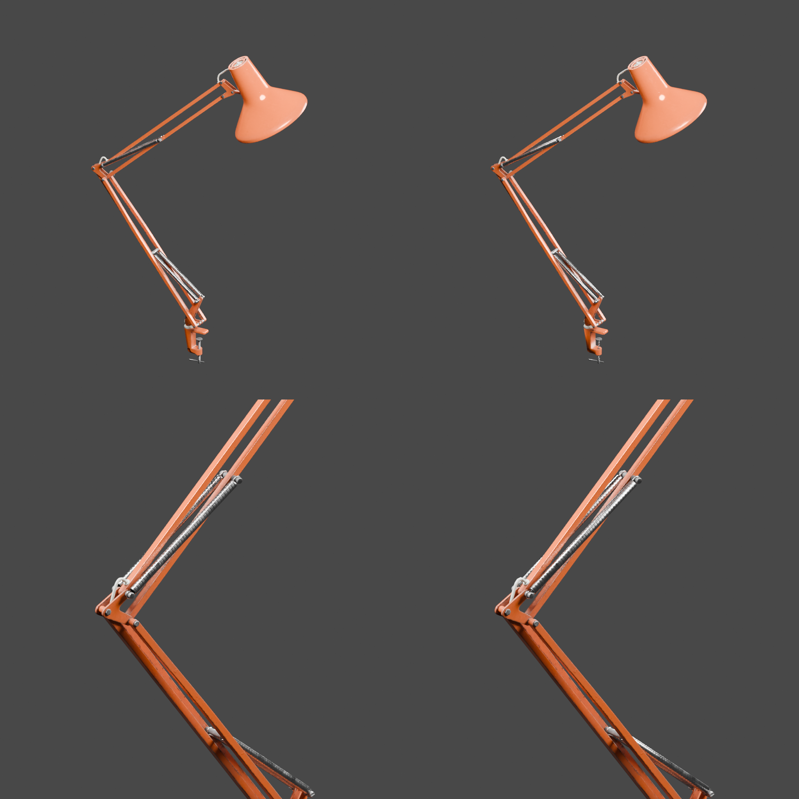

# desk_lamp_arm_01

Reduced the existing **Poly Haven Desk Lamp Arm 01 (CC0)** into a drop-in
GLB. Attribution: [Poly Haven, Desk Lamp Arm 01](https://polyhaven.com/a/desk_lamp_arm_01).
The existing source attribution is already recorded in
`game/assets/core/third_party/ATTRIBUTION.md`; no download or new third-party
asset was used. Source files were neither modified nor moved.

## Deliverables

- `tools/blender/props/desk_lamp_arm_01.py`: deterministic, offline
  `build(out_dir)` and shared headless CLI.
- `game/assets/core/props/desk_lamp_arm_01.glb`: **11,607 triangles**, two
  meshes (`lamp`, `lamp_light`), two original textured PBR materials.
- `assets/previews/desk_lamp_arm_01_{front,iso,detail}.png`: 1024 × 1024,
  shared neutral-grey three-point studio, Cycles **CPU**, 32 samples with
  denoising, four threads.
- `assets/previews/desk_lamp_arm_01_comparison.png`: 2048 × 2048 comparison.
- `assets/meta/desk_lamp_arm_01.json`: actual counts, texture sizes, source
  credit and hashes, script/pipeline/GLB hashes, source/final bounds,
  reduction categories and render settings.

## Source comparison and reduction

**Left: original source. Right: reduced GLB geometry.** Top: full lamp.
Bottom: spring and elbow detail. Each pair uses the same camera, framing,
lighting, render settings and seed. Personally inspected all previews.



The imported source measures **24,102 triangles**, rather than the request's
approximate 25.7k. The reduction removes **51.84%** of those triangles and
meets the requested 12,000 target as well as the 20,000 hard limit.

The script separates disconnected source surfaces without welding UV or
normal boundaries. It first dissolves coplanar tessellation with UV,
normal, sharp-edge and material delimiters, then applies component-specific
collapse ratios. Hidden clamp/thread detail receives the strongest reduction;
dense joints, tiny fasteners, shade surfaces and bulb receive controlled
reductions. Low-density arm members, springs and shade rim retain their
geometry apart from redundant planar tessellation. Components are joined
into the two requested mesh names. All exported faces are triangles, all
modifiers are applied, and UVs, normals and tangents are exported.

The three **1024 × 1024 source JPEGs are embedded byte-identically**: diffuse,
tangent normal and packed roughness/metallic atlas. The two material definitions,
including double-sided surfaces and the light's emission factor
`[1, 0.9837890267372131, 0.649111270904541]`, match the original glTF.
Original material/image names are retained, as the request requires;
there is no rebake, replacement atlas or additional material. No lights,
cameras, collisions or animation are exported.

Both mesh transforms are identity at the original source origin. No
translation, rotation, scale or orientation correction was introduced.
The maximum change of a bounding-box extremum is **0.095 mm**. The room
instance can retain its existing transform.

## Verification actually run

`tools/blender/build_assets.sh desk_lamp_arm_01`: **exit 0**. Real output
excerpt (full log: `assets/cache/desk_lamp_arm_01/build.log`):

```text
Building desk_lamp_arm_01 with Blender 5.2.2 (CPU only, 4 threads)
SOURCE: 24102 triangles; source origin and identity transforms preserved
ASSET BUILT: ~/Work/escapebox/game/assets/core/props/desk_lamp_arm_01.glb; 11607 triangles; 2 materials; 2 parts
```

The exporter emits its existing shared-image sampler warning for both
materials. Their exported material definitions and embedded images were
checked against the source:

```text
WARNING: More than one shader node tex image used for a texture. The resulting glTF sampler will behave like the first shader node tex image.
PASS textures: all 3 embedded JPEGs byte-identical to CC0 source (1024 x 1024)
PASS materials: source names, double-sided surfaces and emission factor preserved
PASS export: 2 named meshes, identity placement, UVs/normals/tangents, triangles only; no cameras/animations
PASS integrity: GLB/script/source file hashes match metadata
```

Blender also emits `Modifier requires more than 3 input faces` for the
collapse step on three components already flattened to three or fewer
polygons by planar dissolution. Blender leaves those surfaces intact;
the following triangulation exports them normally. The final geometry
count and source-comparison checks include these surfaces.

Godot 4.7.2 headless direct `GLTFDocument.append_from_file` and
`generate_scene`, in an isolated project under this asset's cache:
**exit 0**, with real output:

```text
PASS Godot headless: GLB loads; 2 named meshes; 11607 triangles; identity placement; textured PBR materials and bulb emission
```

`go run ./tools/assetcheck desk_lamp_arm_01`: **exit 1**, with complete real
output:

```text
WARN desk_lamp_arm_01: request: no Triangles budget found; using the set default 20000
FAIL desk_lamp_arm_01: origin not on floor plane: bounds min y = -0.0880 m (want 0 +/- 1 mm); bounds min (-0.1186, -0.0880, -0.2967) max (0.0833, 0.8046, 0.3172)
FAIL desk_lamp_arm_01: origin not at base centre: bounds centre x = -0.0176, z = 0.0103 m (want 0 +/- 5 mm); bounds min (-0.1186, -0.0880, -0.2967) max (0.0833, 0.8046, 0.3172)
assetcheck: 1 asset(s) checked, 0 passed, 1 failed, 1 warning(s)
exit status 1
```

## Acceptance blocker and integration

**Assetcheck acceptance is blocked by the request/validator origin mismatch.**
The source is a desk-clamp lamp: its underside extends 87.994 mm below
its mounting origin, and the articulated lamp is not centred on that
origin. The request explicitly requires the original origin, scale and
orientation so the room transform stays unchanged. Assetcheck applies a
floor-centred origin by default because the request has no Transforms
section describing another supported origin. Recentering to satisfy that
check would violate the explicit drop-in requirement. No attempt was made
to disguise or suppress the failure. The warning about the triangle budget
comes from the request's prose-only Deliverable section; the script itself
enforces 12,000, and the independent geometry checks enforce the mesh names.

The runtime/tooling owner must support a preserved source/clamp origin in
the validator to accept this drop-in asset, or revise the placement
requirement and handle the room adjustment. Validator and room edits are
outside this task's lane. No request status or acceptance checkbox was
changed. In-engine visual acceptance remains Claude's step; the headless
load check is not an in-room screenshot.

Keep the original light material and the existing room lamp light during
integration. No new material tuning is required. Only this lamp's
script, GLB, previews, metadata, report and isolated cache were written;
shared helpers, source files, other assets, runtime, room scenes and
room.yaml were not edited. No commit was made.

## Final repeat-build check

Ran the final script twice through `tools/blender/build_assets.sh
desk_lamp_arm_01`; both returned **exit 0**, with the shared lock respected
while the other asset process used Blender. The two final GLBs are
**byte-identical**, 2,687,504 bytes. Metadata is identical except `built_at`.
Real independent comparison output:

```text
PASS reproducibility: byte-identical GLB; metadata identical except built_at
SHA256 2bcee2f545da2d656f5b617aceba5b53b44fba12994aace06012b63ebb4b3ebd
```

Re-ran the source-texture/material/hash inspection, Godot headless loading
and `go run ./tools/assetcheck desk_lamp_arm_01` after the repeat build.
The independent checks and Godot returned **exit 0**; assetcheck returned
**exit 1**, with exactly the origin failures and single request-budget
warning printed above. Python source syntax also passed. Final logs:
`assets/cache/desk_lamp_arm_01/build_reference.log`, `build.log`,
`verify.log`, `godot-check.log` and `assetcheck.log`.
